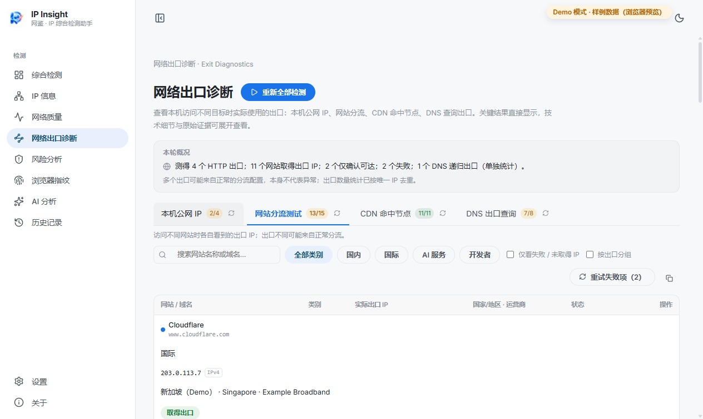
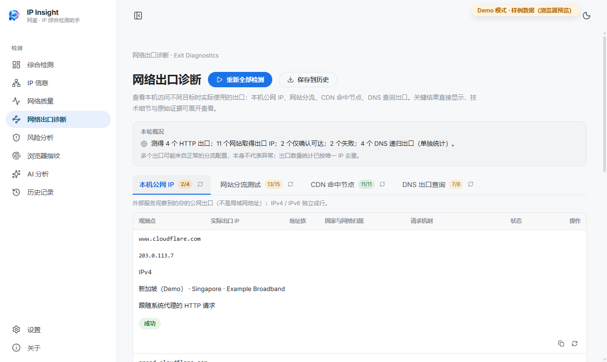
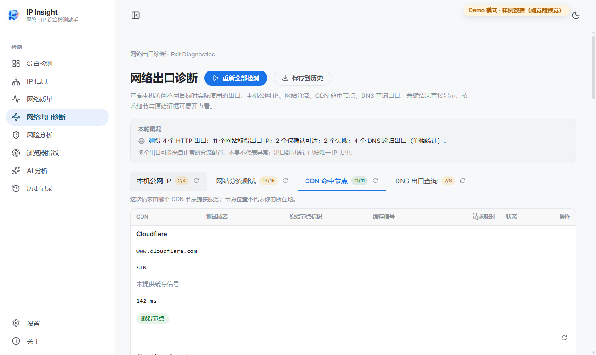
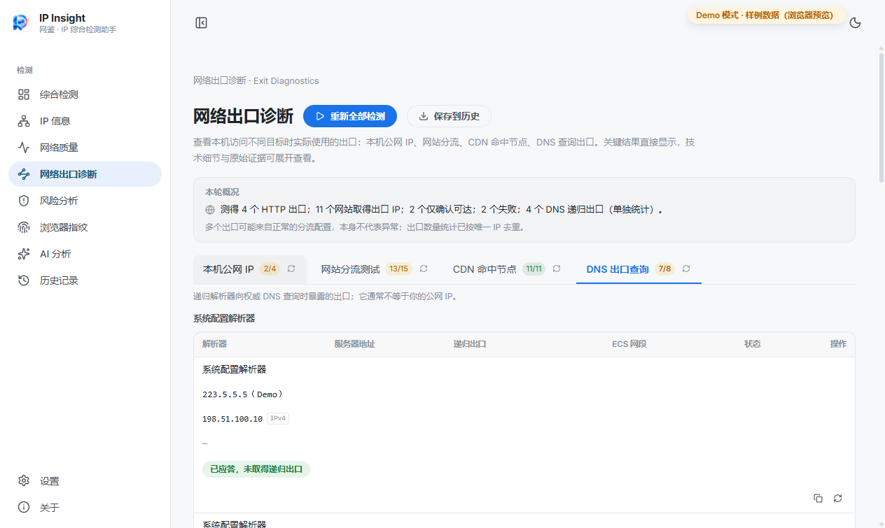
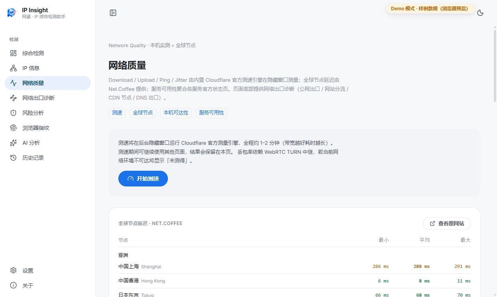
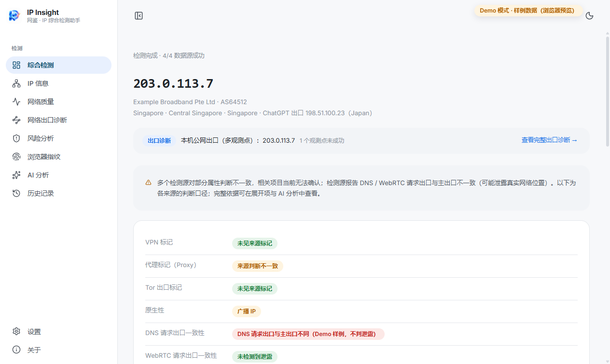
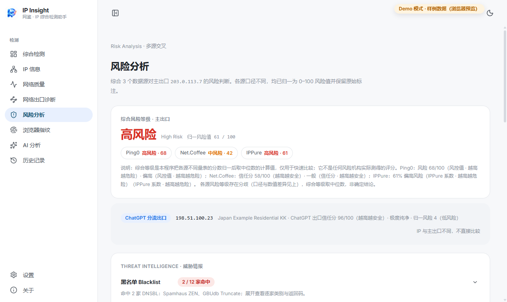
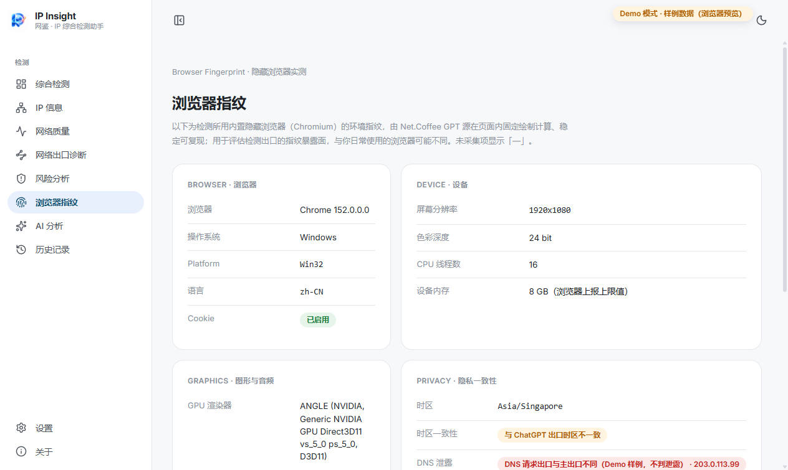
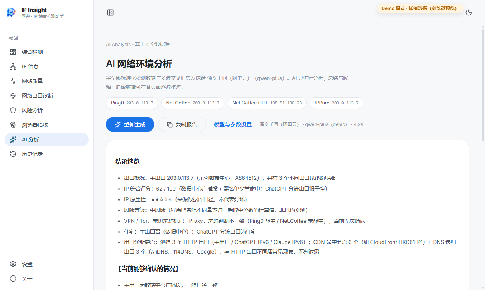
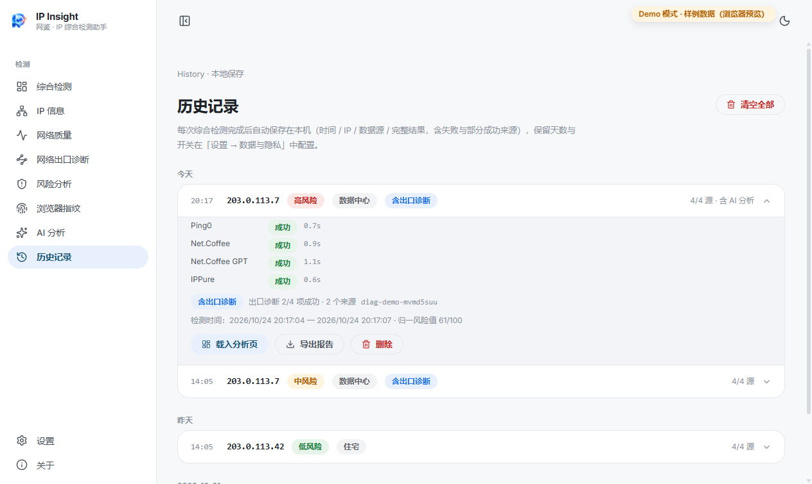

<div align="center">


# 网鉴 · IP Insight

**多源 IP 检测聚合 + 网络出口诊断 + AI 综合分析的网络环境检测助手（Windows 桌面软件）**

[简体中文](README.md) · [English](README_EN.md)


版权所有 © 2026 [薛泽（Xue Ze）](https://github.com/xueze-ai)

</div>

---

## 项目介绍

网鉴（IP Insight）是一个免费开源的 Windows 桌面软件，回答一个常见但不好答的问题：**「我的网络环境到底长什么样？」**

它把三类能力装进一个应用：

1. **多源 IP 检测聚合**：自动访问 Ping0、Net.Coffee、Net.Coffee GPT、IPPure 四个检测网站，交叉验证同一台机器的 IP 画像、风险与泄露判断；
2. **网络出口诊断**：从独立观测点实测「本机访问不同目标时各自使用的出口」——公网 IP、网站分流、CDN 命中节点、DNS 查询出口；
3. **AI 综合分析**：把检测与诊断数据交给你在本机配置的大模型，输出能看懂、有依据、分清「能确认 / 不能确认」的报告。

**当前版本 v0.2.3**（变更见 [CHANGELOG.md](CHANGELOG.md)）。

**系统要求**：Windows 10/11 x64。无需安装 Node / Python 等开发环境。

**直接下载**：到 [Releases](https://github.com/xueze-ai/IP-Insight/releases) 下载——

| 文件 | 适合 |
| --- | --- |
| `IP-Insight-<版本>-Setup.exe` | 安装版（NSIS，开始菜单 / 桌面快捷方式，支持自动更新） |
| `IP-Insight-Portable.zip` | 便携版（解压即用，不写注册表） |
| `SHA256SUMS.txt` | 完整性校验：`certutil -hashfile <文件名> SHA256` 比对哈希 |

> 未签名应用首次运行如遇 SmartScreen：「更多信息 → 仍要运行」。免费的代码签名路线见 `docs/code-signing.md`。
> WinGet 清单已就绪（`winget/`），是否实际以上架为准请以 `winget search` 实测结果为准。

---

## 三分钟上手

1. **选版本**：日常使用选安装版；不想安装选便携版。
2. **开始检测**：打开软件 → 首页点「开始综合检测」（约 30–60 秒，四个数据源自动跑完）。
3. **看结果**：
   - 首页给出主出口 IP、运营商与关键属性摘要；
   - 「网络出口诊断」页看访问不同网站时的真实出口；
   - 「风险分析」页看多源风险口径与分歧项；
   - 想要一段能读懂的总结 → 「AI 分析」页点「生成分析」（先在设置里配好任意一家 AI 提供商，或本地 Ollama 免 Key）。
4. **留存**：每次检测自动存入本机历史；随时导出 HTML / PDF / JSON / TXT 报告。

> 不想安装也想先看界面？仓库内置 **Demo 模式**：`npm install && npm run build && npm run preview:web`，浏览器打开提示地址即可（样例数据，顶栏有 Demo 徽标）。

---

## 功能导览（每个页面解决什么问题）

| 页面 | 解决的问题 |
| --- | --- |
| 综合检测 | 「我现在用的网络环境整体如何？」——四源交叉 + 摘要 |
| IP 信息 | 「这个 IP 的归属与网络信息是什么？」——多源字段对比 |
| 网络质量 | 「网速、到各地的延迟、哪些站可达？」——测速 / 全球节点 / 可达性 / 服务状态 |
| **网络出口诊断**（新） | 「访问不同网站时，我实际从哪个出口出去？」——四模块实测 |
| 风险分析 | 「这个 IP 被标记为什么？各源判断一致吗？」——威胁情报与口径说明 |
| 浏览器指纹 | 「检测方能看到我浏览器的哪些特征？」——五组分类 + 明细 |
| AI 分析 | 「帮我把这些数据讲成人话」——流式报告 + 场景咨询 |
| 历史记录 | 「上次/上周的结果是什么？」——本机快照 + 载入 + 导出 |

---

## 网络出口诊断（0.2.3 重点）

左侧导航「网络出口诊断」进入独立页面；顶部一键「开始全部检测」，概览给出一句话统计，例如：

> 测得 3 个 HTTP 出口；8 个网站取得出口 IP；2 个仅确认可达；1 个失败；4 个 DNS 递归出口（单独统计）。

页面内四个标签可独立运行，切换标签保留结果。

### ① 网站分流测试（默认标签）

**有什么用**：查看访问不同网站时，各自真实看到的出口 IP；出口不同可能来自正常的分流配置，本身不代表异常。



**结果怎么看**：每行 = 一个网站。目标分类（国内 / 国际 / AI / 开发者）只表示「测的是哪类站」；旗帜无关的「国家/地区 · 运营商」列是**按测得出口 IP 查询的归属**（来源与时间在详情里）。回显出口的目标显示真实 IPv4/IPv6；不回显的明确写「可访问，未提供出口 IP」，绝不用主出口或别的站结果补齐。

支持：搜索网站/域名、按类别筛选、仅看失败/未取得 IP、按出口分组、复制 IP / 复制整表、单项重试 / 重试全部失败项。行点击展开详情（实际 URL、请求机制、HTTP 状态、耗时、测量时间、数据来源、尝试历史与原始证据）。

**实际限制**：只测试各目标官方提供的诊断端点；结果代表该端点，不能宣称整个网站全部资源走同一出口，更不能据「端点可达」判断「服务已解锁」。

### ② 本机公网 IP

**有什么用**：外部服务观察到的你的公网出口（不是局域网网卡地址）。



**结果怎么看**：每个观测点一行；IPv4 / IPv6 独立成行，只有 IPv6 成功时也保留真实地址。请求机制明确区分「跟随系统代理的 HTTP 请求」与「Node https 强制 IPv6 直连（不经应用层代理）」——后者仍可能被系统路由 / TUN 接管，只说明它自己的路径。

**实际限制**：无 IPv6 连通时显示中性「不支持」，不判网络异常；不同观测点看到不同出口时并列展示，不合并成唯一「真实 IP」。

### ③ CDN 命中节点

**有什么用**：这次请求由哪个 CDN 边缘节点提供服务。



**结果怎么看**：节点标识保留**原始完整值**（如 `HKG61-P1`、`cache-hkg17922-HKG`），不裁剪也不推断城市；缓存信号按响应头出现顺序全部保留（如 `Miss from cloudfront → Hit from cloudfront` 不会简化成 HIT）。

**实际限制**：CDN 节点位置不代表你的所在地，也不等于 DNS 解析结果或你的公网出口；耗时是 HTTP 请求耗时，不是 ICMP Ping；响应不回显 PoP 的 CDN 只记可达性。

### ④ DNS 出口查询

**有什么用**：递归解析器向权威 DNS 查询时暴露的出口——它通常**不等于**你的公网 IP。



**结果怎么看**：分两组——「系统配置解析器」与「指定公共 DNS（UDP 直连）」。字段语义依据 Google / Akamai 官方说明：Akamai 的 `ns` 段是解析器出口，`ip` 段是 ECS 网段代表地址（不计作出口），`ecs` 段是客户端网段；仅取得 ECS / TXT 时不输出猜测的出口。按服务器地址自动选择 udp4 / udp6。

**实际限制**：指定公共 DNS 的结果不能冒充「浏览器当前实际 DNS」；本测试不能完整代表浏览器安全 DNS（DoH）、应用自带 DoH、代理远端解析和系统分域规则。**DNS 出口与 HTTP 出口不同是常见现象，不能单凭这一点判定「DNS 泄露」。**

> 全部端点于 2026-10-24 逐个真实核验；数据来源、字段含义与已知限制详见 [docs/exit-diagnostics-data-sources.md](docs/exit-diagnostics-data-sources.md)。

---

## 网络质量

顺序：**测速 → 全球节点延迟 → 本机可达性 → 服务可用性**。页首提供四个分区的快捷定位。



- **测速**：内置 Cloudflare 官方引擎（下载 / 上传 / 延迟 / 抖动 / 负载延迟；丢包依赖 WebRTC TURN，不可达时如实显示「未测得」而非 0）。
- **全球节点延迟**：20 节点 min/avg/max（来自 Net.Coffee 源）。
- **本机可达性**：测试**本机能否收到目标响应**；收到响应不代表账号、地区、权限或整个服务已经可用。
- **服务可用性**：展示各服务**官方状态页的公开信息**（本机不对服务本身发起探测）；「全部正常」同样不代表你的账号或地区已开通。

---

## 多源结果、风险和指纹怎么看

- **综合检测与多源结果**：首页完成检测后点「查看完整检测结果」展开逐源卡片与多源一致性矩阵——一致打 ✓、分歧标 ⚠ 并逐源列出，不替你拍板单一结论。
- **风险分析**：综合等级是「程序把各源不同量表归一后取中位数的计算值」，页面明确标注其计算性质与每个源的原始口径；ChatGPT 分流出口单独成卡，不与主出口混比。
- **浏览器指纹**：数据来自应用内置检测浏览器（与你日常 Chrome/Edge 可能不同，页面有说明）；「存在指纹」本身不是风险，也不暗示已被跟踪。

---

## AI 配置、历史记录与导出

### AI（可选，不配置也全功能可用）

设置 → AI 提供商，内置 9 家 OpenAI 兼容提供商 + 自定义 + **本地 Ollama（免 Key，数据不出本机）**。API Key 仅保存在本机 `%AppData%/IP-Insight/settings.json`，作为登录凭据直接发送给你选择的提供商服务器（本软件不代理、不存储到别处）；检测完成后**不会**自动触发 AI 上传，只有你点「生成分析」才发送有界摘要。

报告结构：能确认的情况 / 值得注意 / 还不能确认 / 多源一致性与口径 / 建议下一步。AI 页也支持场景咨询（「这个 IP 适合打游戏吗」）；**独立出口诊断快照可以单独交给 AI 分析**，不必先跑多源检测。



### 历史记录

每次综合检测自动保存（含失败与部分成功来源 + 关联的出口诊断摘要）；出口诊断页跑完的完整诊断也可「保存到历史」为独立快照。载入历史后界面顶部显示「当前查看：历史记录」横幅——历史是不可变快照，后台实时检测不会覆盖它。

### 导出

HTML / PDF / JSON / TXT 四种格式与当前选中快照一致：易读摘要 + 关键数据 + 来源 + 时间 + 状态 + 失败原因，并保留专业明细（含出口诊断的归属 / 节点 / 缓存信号 / ECS 列；PDF 长表格与 IPv6 不溢出）。JSON 额外含完整结构化数据。

---

## 隐私、数据位置和常见问题

### 隐私边界

| 数据 | 位置 | 说明 |
| --- | --- | --- |
| 设置（含 AI API Key） | 本机 `%AppData%/IP-Insight/settings.json` | 不上传任何服务器 |
| 历史记录（含出口诊断快照） | 本机 `%AppData%/IP-Insight/history.json` | 可关闭 / 限天数 / 退出即清 |
| 检测与诊断过程 | 内存 | 除历史外不写磁盘；原始证据截断脱敏，不存 Cookie / 授权头 / 会话令牌 |

第三方请求一览（详见 [PRIVACY.md](PRIVACY.md)）：

- 检测网站（Ping0 / Net.Coffee / IPPure / ip.skk.moe 页面流程）：与你手动用浏览器打开无异；
- 出口诊断目标：Cloudflare 官方 trace、各目标官方诊断端点、公开性能测试资源（见数据源文档）；
- **出口 IP 归属查询**：对测得的唯一出口 IP 查询公共归属 API（ip-api.com，回退 ipwho.is；按 IP 去重、并发限制 2、10 分钟缓存；部分目标如哔哩哔哩/IPIP.net 的归属由目标自身提供并注明来源）；
- DNS 出口查询：向系统与公共解析器发送官方诊断 TXT 区查询（Google / Akamai）；
- AI 提供商：仅当你主动点「生成分析 / 咨询」时，发送标准化结果 + 有界诊断事实行。

本软件不采集浏览历史、本地文件、剪贴板；无遥测 / 统计 / 崩溃上报。隐藏浏览器窗口具有正常 Chromium 缓存与网站存储（位于本机 userData），用于与真实浏览器一致的行为；可在设置中清空或直接删除该目录。

### 常见问题

| 现象 | 处理 |
| --- | --- |
| SmartScreen 拦截 | 未签名所致：「更多信息 → 仍要运行」 |
| 某源「需要人工验证」 | 站点出现人机验证；「查看原网站」手动完成后再测（本软件不绕过验证） |
| ip.skk.moe 显示验证页 | 站点对当前出口启用了 Cloudflare 挑战；如实报告，可手动过验证后重试 |
| 出口诊断某行 403 / 429 | 目标拒绝或限流（行内注明具体原因）；可稍后单项重试 |
| 全球节点为「—」 | 先完成一次综合检测（数据来自 Net.Coffee 源） |
| 丢包率「未测得」 | 依赖 WebRTC TURN，网络不可达时不提供该项（非 0） |
| 归属列「未获取」 | 出口 IP 已取得但公共归属 API 查询失败；IP 保留，行不算失败 |
| DNS 出口与公网 IP 不同 | 常见现象（运营商集群解析 / ECS 等），不等于「DNS 泄露」 |
| 可达性 / 服务状态正常但用不了 | 这两项只说明「能收到响应」和「官方说正常」，不代表账号 / 地区 / 权限可用 |
| AI 连接失败 | 设置中「测试连接」查看服务端真实报错 |
| 可达性与浏览器体验不一致 | 探测走系统代理；仅浏览器插件内的代理不经过探测 |
| 打包下载组件超时 | 用 npmmirror 镜像：`ELECTRON_MIRROR=https://npmmirror.com/mirrors/electron/ npm run dist` |

---

## 源码运行、构建与验证

```bash
git clone https://github.com/xueze-ai/IP-Insight.git
cd IP-Insight
npm install

npm run dev            # 开发模式（Electron）
npm run typecheck:node && npm run typecheck:web   # 类型检查（两侧 0 错误）
npm run build          # 三端构建
npm run dist           # Windows 打包：NSIS 安装包 + 便携 zip + SHA256SUMS
node scripts/test-textparse.cjs   # 解析单元测试（脱敏真实样例，不依赖外站）
node scripts/capture-demo.cjs     # 重新生成 docs/images 截图（逐张断言，失败即报错）
```

自动化验证钩子（真实窗口 + 真实网络）：

```bash
IPI_AUTO_TEST=diag npm run dev -- -- --env  # 或直接对 out/main/index.js 运行：
# IPI_AUTO_TEST=diag IPI_DIAG_MODULES=publicIp,splitTunnel,cdnNode,dnsExit electron out/main/index.js
#   → 真实采集四模块，写 test-output/diag.result.json
# IPI_UI_VERIFY=1 / _HIST / _RISK / _SETTINGS / _FP / _EXIT
#   → 真实窗口全流程回归（检测 / 历史+四格式导出 / 风险 / 设置 / 指纹 / 出口诊断）
```

验证记录（区分通过 / 失败 / 受环境限制）：[docs/verification-0.2.3.md](docs/verification-0.2.3.md)。
截图清单与生成方法：[docs/screenshots.md](docs/screenshots.md)。

### 目录结构

```
├─ src/
│  ├─ main/                  # Electron 主进程
│  │  ├─ index.ts            # 窗口 / IPC / 验证钩子
│  │  ├─ settings.ts / history.ts / exportReport.ts / i18n.ts
│  │  ├─ ai/                 # SSE 流式客户端 / 分析提示词
│  │  ├─ diag/               # 网络出口诊断：targets（目标配置）/ probes（探测）/ 
│  │  │                      # textparse（纯解析，可单测）/ geo（归属查询）/ orchestrator（编排）
│  │  └─ providers/          # 每站点一个 Adapter + 隐藏浏览器底座
│  ├─ preload/               # contextBridge 最小 API 面
│  ├─ renderer/              # React UI（Material 3）
│  │  ├─ src/pages/          # 页面（含独立的 ExitDiagnostics）
│  │  ├─ src/state/          # DetectionContext / diag / ai / nav stores
│  │  └─ src/utils/          # 多源共识 / 报告模型
│  └─ shared/                # 统一数据模型 / 出口诊断模型 / API 类型
├─ docs/                     # 数据源说明 / 验证记录 / 截图清单 / 截图
└─ scripts/                  # 打包收尾 / 单元测试 / 截图与校验脚本
```

---

## 贡献

欢迎 Issue / PR：

1. Fork 并创建 `feat/xxx` / `fix/xxx` 分支；
2. 保持「每站点一个 Adapter」「统一数据模型」「不伪造数据、不绕过验证」约束；
3. `npm run typecheck:node && npm run typecheck:web && npm run build` 通过后提交；
4. PR 描述说明动机、改动面与验证方式。

行为准则：友好、就事论事；尊重数据源的服务条款。

## 许可证

[MIT License](LICENSE)：可免费使用、修改、分发、商用，**唯一条件是保留版权声明（Copyright © 2026 薛泽 Xue Ze）**。分发时请同时保留软件内「关于」页的作者与仓库信息。

## 更新日志

见 [CHANGELOG.md](CHANGELOG.md)（0.2.3：出口诊断独立成页 + 四模块表格化 + 真实归属链路 + 搜索/筛选/分组/复制/重试 + 状态与快照关联修复 + README 与截图全面重做）。

---

<div align="center">

**网鉴 · IP Insight** — 让每一次出口 IP 都看得清清楚楚。

Copyright © 2026 [薛泽（Xue Ze）](https://github.com/xueze-ai) · MIT License

</div>
