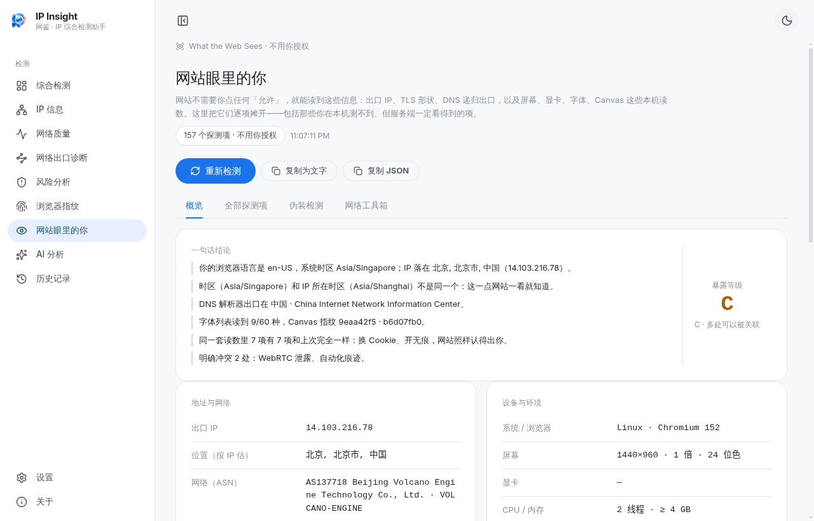
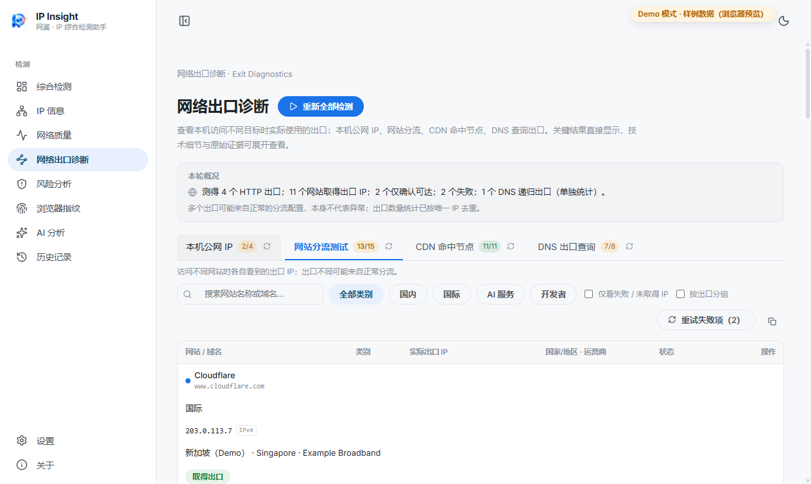
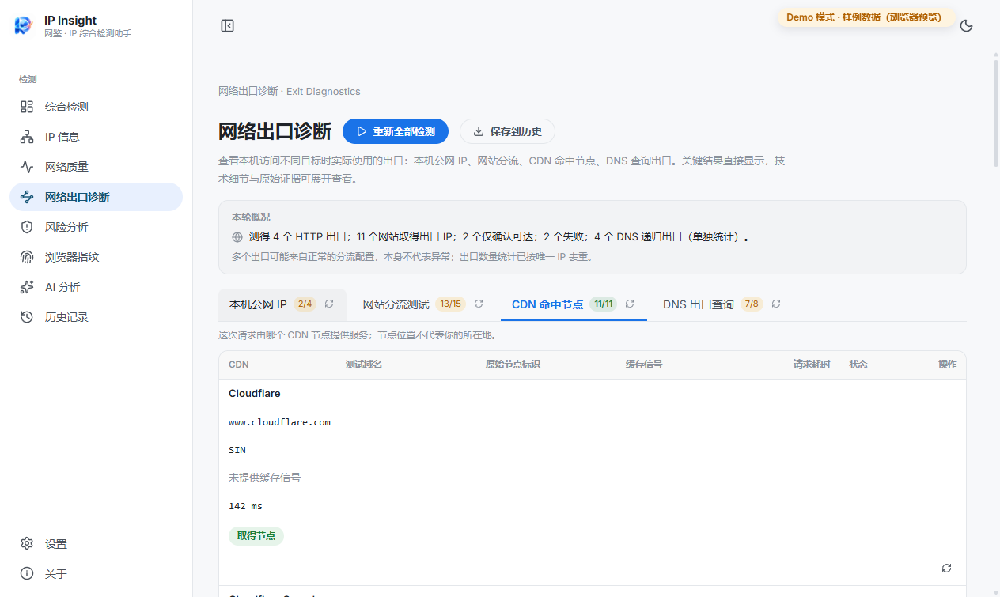
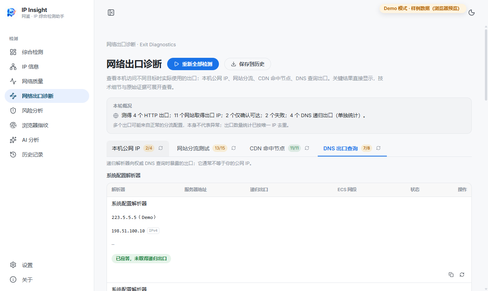

<div align="center">


# 网鉴 · IP Insight

**不用授权，看清网站眼里的你。**

多源 IP 检测聚合 · 网络出口诊断 · 浏览器指纹与暴露面 · AI 综合分析

[简体中文](README.md) · [English](README_EN.md) · [下载](https://github.com/xueze-ai/IP-Insight/releases) · [更新日志](CHANGELOG.md)


</div>

---

## 这是什么

一个免费的 Windows 桌面工具，回答一个大多数人都答不上来的问题：**在网站眼里，我到底是什么样子？**

你打开任何网页，都不用点「允许」，对方就已经知道你的出口 IP、归属、ASN、DNS 解析器、TLS 与 HTTP 版本、系统与浏览器版本、屏幕、显卡、字体、时区与语言、Canvas / WebGL / 音频指纹，甚至能判断你的 UA 和真正开连接的那台机器对不对得上。IP Insight 把这些读数逐项摊开，并给出「哪些能确认、哪些只是推测」。

它做四件事：

- **多源交叉**：Ping0 / Net.Coffee / Net.Coffee GPT / IPPure 四家同时查，同一个 IP 的画像、风险与泄露判断并排比对，分歧标出来，不替你拍板；
- **出口透视**：访问不同网站时，各自看到的出口 IP 一样吗？CDN 命中哪个节点？DNS 递归出口在哪？
- **暴露面体检**（0.3.1）：157 项网站可读信息、指纹稳定性、13 组带证据的伪装判定、目标地区模拟，加上路由追踪 / 网络诊断 / CDN 雷达；
- **AI 总结**（可选）：把结果交给你自己配置的模型（含本地 Ollama），输出「能确认 / 值得注意 / 还不能确认 / 建议下一步」。

不采集浏览历史、不上报遥测、不替你连任何服务器——除了检测本身要访问的公开端点。



---

## 下载与安装

到 [Releases](https://github.com/xueze-ai/IP-Insight/releases) 选一个：

| 文件 | 说明 |
| --- | --- |
| `IP-Insight-0.3.1-Setup.exe` | 安装版（NSIS）：开始菜单 / 桌面快捷方式，支持应用内更新 |
| `IP-Insight-Portable.zip` | 便携版：解压即用，不写注册表，可放 U 盘 |
| `SHA256SUMS.txt` | 校验和：`certutil -hashfile <文件> SHA256` 比对 |

系统要求：Windows 10 / 11 x64。不需要装 Node、Python 或任何运行库。

> 安装包未做代码签名，首次运行可能被 SmartScreen 拦：点「更多信息 → 仍要运行」。校验哈希后仍不放心，可以按下面的步骤自己构建。

---

## 三分钟上手

1. 打开软件，首页点「开始综合检测」，约 30–60 秒跑完四个数据源；
2. 「网络出口诊断」看你访问不同站点时各走哪个出口；
3. 「网站眼里的你」看这台机器给网站留下了什么，以及代理 / VPN 有没有露馅；
4. 想读懂这些数字：「AI 分析」→「生成分析」（先配一家提供商，或本地 Ollama 免 Key）；
5. 每次检测自动存本机历史，可导出 HTML / PDF / JSON / TXT。

不想装也能先看界面：仓库内置 Demo 模式，`npm install && npm run build && npm run preview:web`，浏览器打开提示的地址即可（样例数据，顶栏有 Demo 徽标）。

---

## 功能一览

| 页面 | 解决的问题 |
| --- | --- |
| 综合检测 | 我现在的网络环境整体如何？四源交叉 + 摘要 |
| IP 信息 | 这个 IP 的归属与网络信息是什么？多源字段对比 |
| 网络质量 | 网速、到各地的延迟、哪些站可达、服务状态 |
| 网络出口诊断 | 访问不同网站时，我实际从哪个出口出去？ |
| 风险分析 | 这个 IP 被标记成什么？各源说法一致吗？ |
| 浏览器指纹 | 检测方能看到浏览器哪些特征？五组分类 + 明细 |
| **网站眼里的你** | 不用授权，网站能读到这台机器的什么？ |
| AI 分析 | 把数据讲成人话，并区分确认与猜测 |
| 历史记录 | 上次 / 上周的结果是什么？快照、载入、导出 |

### 网站眼里的你（0.3.1）

四个标签：概览、全部探测项、伪装检测、网络工具箱。

- **157 项探测**，按「服务器看到的 / 请求头 / 语言和地区 / 指纹 / 设备 / 浏览器设置 / 网络」分组，每项写清来源方法与「为什么这项会暴露你」，等级分「强识别 / 可缩小范围 / 公开信息」；
- **指纹稳定性**：Canvas、WebGL、音频、字体、屏幕、系统时区、浏览器语言，7 项和上次对比，变没变一目了然；
- **伪装检测**：13 组带证据的冲突判定（DNS 泄漏、往返延迟、连接层特征、时区语言与 IP、WebRTC、机房 IP、UA 与真实系统、环境篡改、指纹浏览器痕迹、HTTP/3 与 ECH 等），只报有证据的，并给改法；
- **目标地区模拟**：港 / 新 / 台 / 日 / 美 / 英 / 德，逐项告诉你「还差哪几项、每项怎么改」；
- **网络工具箱**：路由追踪（`tracert -d`）、网络诊断（8 项真实 TCP / DNS / HTTP 检查）、CDN 雷达（10 个 CDN 端点，节点 + 缓存 + 耗时）。

**边界写在明面上**：JA4、HTTP/2、TCP/IP、QUIC 指纹与 UA 回显这 5 项只有服务端能观测，界面标「仅服务端可观测」，不造假读数；没有公共样本库，就不说「全网只有你是这个指纹」；`tracert` / `netsh` 只对 Windows 有效，其他平台如实报不支持。

细节：[docs/features-whoami.md](docs/features-whoami.md) · 来源与测法：[docs/whoami-data-sources.md](docs/whoami-data-sources.md) · 实测记录：[docs/verification-0.3.1.md](docs/verification-0.3.1.md)

<details>
<summary>出口诊断四模块截图</summary>





</details>

---

## 隐私

| 数据 | 在哪 | 说明 |
| --- | --- | --- |
| 设置（含 AI Key） | `%AppData%/IP-Insight/settings.json` | 只在本机 |
| 历史记录 | `%AppData%/IP-Insight/history.json` | 可关闭 / 限天数 / 退出即清 |
| 「网站眼里的你」指纹基线 | 本机 localStorage | 只存 7 个分项的哈希，用于下次对比，可手动清空 |
| 检测过程 | 内存 | 不写盘；原始证据截断脱敏，不存 Cookie / 授权头 / 令牌 |

- 无遥测、无统计、无崩溃上报；
- 只访问检测所必需的公开端点，清单见 [PRIVACY.md](PRIVACY.md)；
- AI 只有在你点「生成分析」时才发送有界摘要，且发给你自己选定的提供商。

---

## 从源码构建

```bash
git clone https://github.com/xueze-ai/IP-Insight.git
cd IP-Insight
npm ci

npm run dev                                        # 开发模式
npm run typecheck:node && npm run typecheck:web    # 类型检查
npm run build                                      # 三端构建
npm run dist                                       # Windows 包：NSIS + 便携 zip + SHA256SUMS
```

国内网络拉 Electron 慢时：

```bash
ELECTRON_MIRROR=https://npmmirror.com/mirrors/electron/ npm run dist
```

辅助脚本：

```bash
node scripts/test-textparse.cjs   # 解析单测（真实样例脱敏，不依赖外站）
node scripts/capture-demo.cjs     # 重新生成 docs/images 截图（逐张断言）
```

真实窗口 + 真实网络的回归钩子：

```bash
IPI_AUTO_TEST=diag npm run dev -- -- --env
# IPI_UI_VERIFY=1 / _HIST / _RISK / _SETTINGS / _FP / _EXIT
```

### 目录结构

```
src/
├─ main/          Electron 主进程：窗口 / IPC / 设置 / 历史 / 导出
│  ├─ ai/         SSE 流式客户端与分析提示词
│  ├─ diag/       出口诊断：targets / probes / textparse / geo / orchestrator
│  ├─ whoami/     网站眼里的你：serverProbe（服务端侧）/ tools（追踪·诊断·雷达）
│  └─ providers/  每站点一个 Adapter + 隐藏浏览器底座
├─ preload/       contextBridge 最小 API 面
├─ renderer/      React + Material 3
│  ├─ pages/      含 ExitDiagnostics / WhoAmI
│  ├─ whoami/     探测目录 / 浏览器侧采集 / 指纹基线 / 伪装判定 / OpenRTB
│  ├─ state/      检测、诊断、AI、导航状态
│  └─ utils/      多源共识与报告模型
└─ shared/        统一数据模型与 API 类型
docs/             数据源说明 / 验证记录 / 截图
scripts/          打包收尾 / 单测 / 截图
```

---

## 参与贡献

1. Fork，从 `feat/xxx` 或 `fix/xxx` 开分支；
2. 守住三条约定：**每站点一个 Adapter**、**统一数据模型**、**不伪造数据 / 不绕过人机验证**；
3. `npm run typecheck:node && npm run typecheck:web && npm run build` 全绿再提 PR；
4. PR 说明动机、改动面与验证方式（涉及读数口径的，附真实样例）。

Issue 里报 bug 时带上：版本号、Windows 版本、复现步骤、截图或「复制文字」结果。判断错了的读数比崩溃更值得报。

## 致谢

- 问题清单的灵感来自 [who.1ms.dog](https://who.1ms.dog/zh-cn/) 这类「网站不用授权能读到什么」的科普站；本项目独立实现，没有复制其代码或数据，也不做它那种全网稀有度统计；
- 感谢 Cloudflare、Akamai、Tor Project、ip-api、ipwho.is 提供的公开诊断端点；
- 感谢 Ping0、Net.Coffee、IPPure 等被聚合的检测站点。

## 许可证

[MIT License](LICENSE)。可免费使用、修改、分发、商用，**唯一条件是保留版权声明**（Copyright © 2026 薛泽 Xue Ze）。再分发时请一并保留「关于」页的作者与仓库信息。

---

<div align="center">

**网鉴 · IP Insight** — 让每一次出口 IP 都看得清清楚楚。

Copyright © 2026 [薛泽（Xue Ze）](https://github.com/xueze-ai)

</div>
