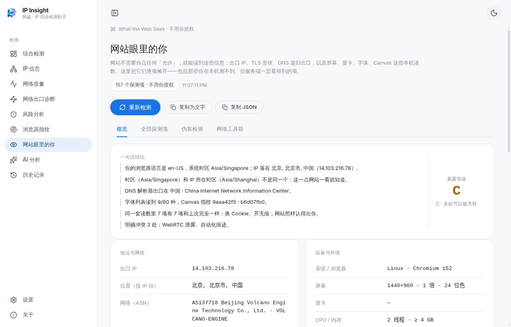
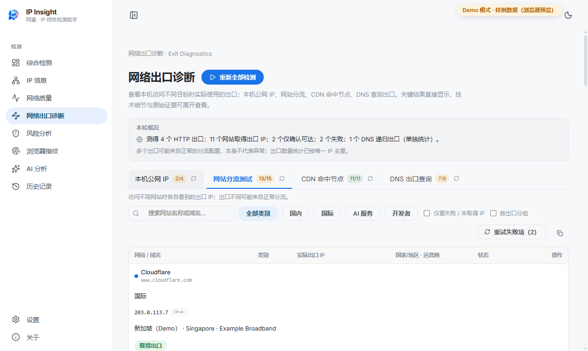
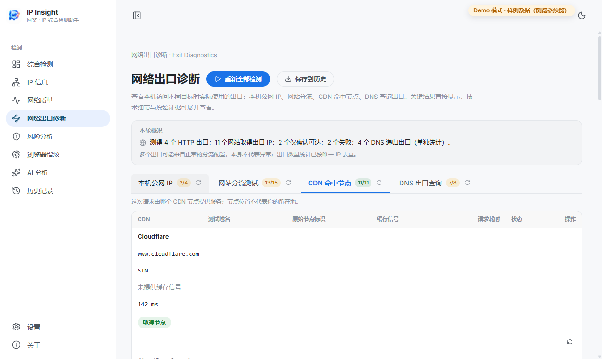
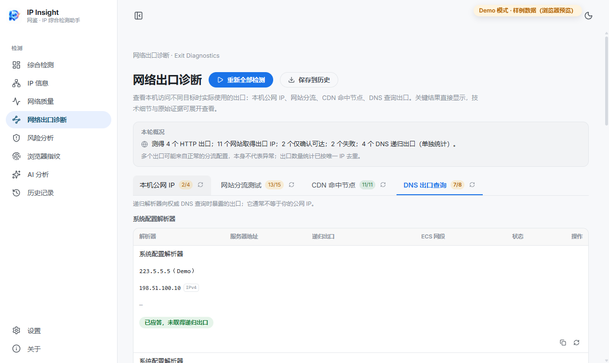

<div align="center">


# IP Insight · 网鉴

**See yourself the way the web sees you — no permissions required.**

Multi-source IP checks · egress diagnostics · fingerprint & exposure surface · AI analysis

[简体中文](README.md) · [English](README_EN.md) · [Releases](https://github.com/xueze-ai/IP-Insight/releases) · [Changelog](CHANGELOG.md)


</div>

---

## What it is

A free Windows desktop app for a question most people cannot answer: **what does a website already know about me?**

Open any page and, without you clicking “Allow”, the server already sees your egress IP, its geolocation, ASN, DNS resolver, TLS and HTTP versions, OS and browser build, screen, GPU, fonts, timezone, language, Canvas / WebGL / audio fingerprints — and it can tell whether your User-Agent matches the machine that actually opened the connection. IP Insight lays those readings out one by one and marks what is confirmed versus what is only inferred.

Four things it does:

- **Cross-check sources** — Ping0, Net.Coffee, Net.Coffee GPT and IPPure queried together; profile, risk and leak verdicts side by side, disagreements flagged, never silently merged;
- **See the egress** — does every site see the same IP? Which CDN edge served you? Where does your DNS resolver exit?
- **Audit your exposure** (0.3.1) — 157 site-readable signals, fingerprint stability, 13 evidence-based disguise checks, a target-region simulator, plus traceroute / network diagnostics / CDN radar;
- **Explain it** (optional) — hand the result to a model you configure (local Ollama works, key-free) and get confirmed / notable / still-unknown / next steps.

No browsing history, no telemetry, no crash reporting. The only outbound traffic is the public diagnostic endpoints the checks themselves need.



---

## Install

Download from [Releases](https://github.com/xueze-ai/IP-Insight/releases):

| File | What it is |
| --- | --- |
| `IP-Insight-0.3.1-Setup.exe` | NSIS installer — Start-menu / desktop shortcuts, in-app updates |
| `IP-Insight-Portable.zip` | Portable — unzip and run, no registry writes |
| `SHA256SUMS.txt` | Checksums — `certutil -hashfile <file> SHA256` |

Requirements: Windows 10 / 11 x64. No Node, Python or runtime needed.

> The build is unsigned, so SmartScreen may warn on first launch: “More info → Run anyway”. Verify the SHA-256, or build it yourself with the steps below.

---

## Three-minute tour

1. Open the app → “开始综合检测” on the home page (~30–60 s, four sources in parallel);
2. **Exit Diagnostics** — which egress each site actually sees;
3. **What the web sees** — the readable traits this machine leaves, and whether a proxy / VPN gives itself away;
4. **AI Analysis** → “生成分析” for a plain-language report (configure a provider first, or local Ollama);
5. Every run is stored in local history; export HTML / PDF / JSON / TXT.

Want to see the UI first? A **Demo mode** ships in the repo: `npm install && npm run build && npm run preview:web`, then open the printed URL (sample data, Demo badge in the top bar).

---

## Pages

| Page | Question it answers |
| --- | --- |
| Overview | How is my network overall? Four-source cross-check + summary |
| IP Info | What are this IP's network attributes? Multi-source field comparison |
| Network Quality | Speed, regional latency, reachability, service status |
| Exit Diagnostics | Which egress do I use per site? |
| Risk Analysis | How is this IP flagged? Do the sources agree? |
| Fingerprint | What browser traits can detectors see? Five groups + detail |
| **What the web sees** | What can a site read without permission? |
| AI Analysis | Explain the data, separating facts from guesses |
| History | What did last week look like? Snapshots, reload, export |

### What the web sees (0.3.1)

Four tabs: Overview, All probes, Disguise checks, Network toolbox.

- **157 probes** grouped as server-visible / request headers / locale / fingerprint / device / browser settings / network. Each row states its source method and *why this reading exposes you*, graded strong identifier / narrowing / public info;
- **Fingerprint stability** — Canvas, WebGL, audio, font list, screen, system timezone, browser language: unchanged or not, versus your previous visit;
- **Disguise checks** — 13 evidence-based conflict tests (DNS leak, round-trip latency, connection-layer traits, timezone/language vs IP, WebRTC, datacenter IP, UA vs real system, tampered environment, anti-detect traces, HTTP/3 + ECH, post-quantum key exchange, …). Only conflicts with evidence are reported, each with a fix;
- **Target-region simulator** — HK / SG / TW / JP / US / GB / DE: how many items already match, which are missing, and how to change each;
- **Network toolbox** — traceroute (`tracert -d`), network diagnostics (8 real TCP / DNS / HTTP checks), CDN radar (10 CDN endpoints: edge node, cache signal, latency).

**Limits are stated, not hidden**: JA4, HTTP/2, TCP/IP and QUIC fingerprints plus server-side UA echo can only be observed server-side — they are labelled “server-side only” instead of being faked. There is no public sample database, so no “you are one in 208,094” claims. `tracert` / `netsh` only work on Windows; other platforms report “unsupported” rather than inventing output.

Details (Chinese): [docs/features-whoami.md](docs/features-whoami.md) · sources & methods: [docs/whoami-data-sources.md](docs/whoami-data-sources.md) · test log: [docs/verification-0.3.1.md](docs/verification-0.3.1.md)

<details>
<summary>Exit diagnostics screenshots</summary>





</details>

---

## Privacy

| Data | Location | Notes |
| --- | --- | --- |
| Settings (incl. AI keys) | `%AppData%/IP-Insight/settings.json` | Local only |
| History | `%AppData%/IP-Insight/history.json` | Can be disabled / limited / cleared on exit |
| Fingerprint baseline | local localStorage | Only 7 component hashes, for comparison; clearable |
| Detection run | Memory | Nothing written; raw evidence truncated and redacted, no cookies / auth headers / tokens |

- No telemetry, no analytics, no crash upload;
- Only the public endpoints required by the checks — full list in [PRIVACY.md](PRIVACY.md);
- AI is contacted only when you click “生成分析”, and only sends a bounded summary to the provider you chose.

---

## Build from source

```bash
git clone https://github.com/xueze-ai/IP-Insight.git
cd IP-Insight
npm ci

npm run dev                                        # dev mode
npm run typecheck:node && npm run typecheck:web    # type checks
npm run build                                      # three-target build
npm run dist                                       # Windows: NSIS + portable zip + SHA256SUMS
```

Slow Electron downloads in mainland China:

```bash
ELECTRON_MIRROR=https://npmmirror.com/mirrors/electron/ npm run dist
```

Helpers:

```bash
node scripts/test-textparse.cjs   # parser unit tests (real, redacted samples)
node scripts/capture-demo.cjs     # regenerate docs/images screenshots with assertions
```

Real-window + real-network regression hooks:

```bash
IPI_AUTO_TEST=diag npm run dev -- -- --env
# IPI_UI_VERIFY=1 / _HIST / _RISK / _SETTINGS / _FP / _EXIT
```

### Layout

```
src/
├─ main/          main process: window / IPC / settings / history / export
│  ├─ ai/         SSE streaming client + analysis prompts
│  ├─ diag/       exit diagnostics: targets / probes / textparse / geo / orchestrator
│  ├─ whoami/     what the web sees: serverProbe / tools (traceroute, diagnostics, radar)
│  └─ providers/  one adapter per source + hidden browser base
├─ preload/       minimal contextBridge API surface
├─ renderer/      React + Material 3
│  ├─ pages/      including ExitDiagnostics and WhoAmI
│  ├─ whoami/     probe catalog / browser collection / baseline / disguise / OpenRTB
│  ├─ state/      detection, diagnostics, AI, navigation stores
│  └─ utils/      multi-source consensus and report model
└─ shared/        shared data models and API types
docs/              data sources / verification / screenshots
scripts/           release finalisation / tests / screenshot capture
```

---

## Contributing

1. Fork, branch from `feat/xxx` or `fix/xxx`;
2. Keep three rules: **one adapter per source**, **one shared data model**, **never fake data or bypass human verification**;
3. `npm run typecheck:node && npm run typecheck:web && npm run build` must pass;
4. In the PR, state the motivation, the touched surface and how you verified it (attach a real sample for changes to reading semantics).

When filing a bug, include version, Windows build, steps, and a screenshot or the “copy as text” output. A wrong reading matters more than a crash.

## Credits

- The question list was inspired by sites like [who.1ms.dog](https://who.1ms.dog/zh-cn/) that explain what a website can read without permission. This project is an independent implementation — no copied code or data, and no site-wide rarity statistics;
- Thanks to Cloudflare, Akamai, Tor Project, ip-api and ipwho.is for public diagnostic endpoints;
- Thanks to Ping0, Net.Coffee and IPPure, whose results are aggregated.

## License

[MIT](LICENSE). Free to use, modify, distribute and sell, provided the copyright notice is kept (Copyright © 2026 Xue Ze / 薛泽). When redistributing, keep the author and repository info in the About screen as well.

---

<div align="center">

**IP Insight · 网鉴** — every egress IP, finally legible.

Copyright © 2026 [Xue Ze（薛泽）](https://github.com/xueze-ai)

</div>
