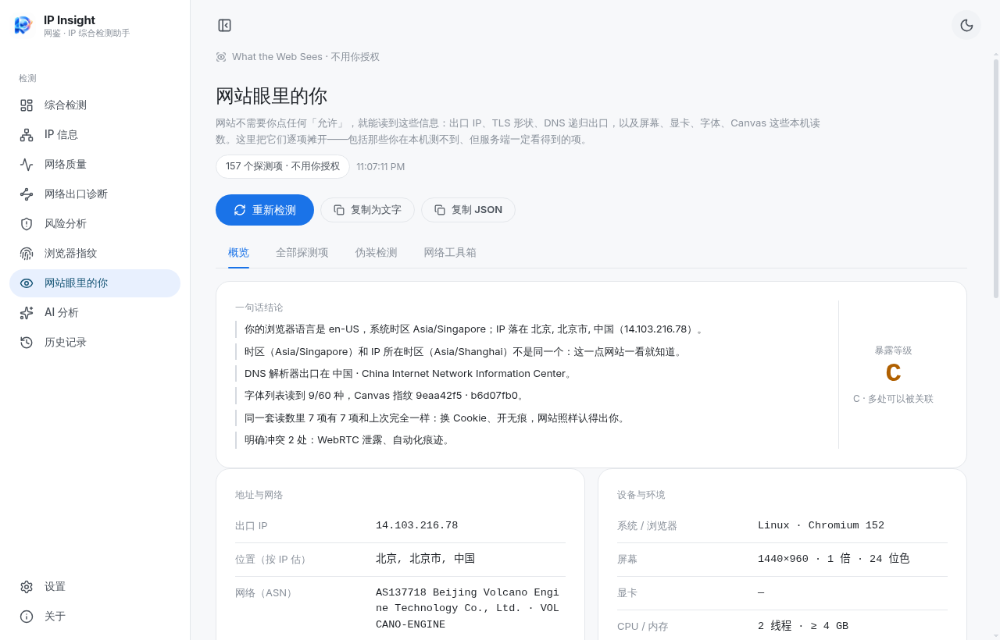
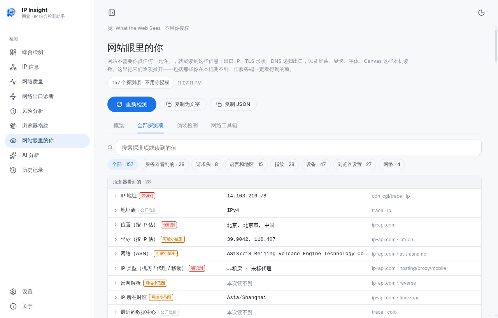
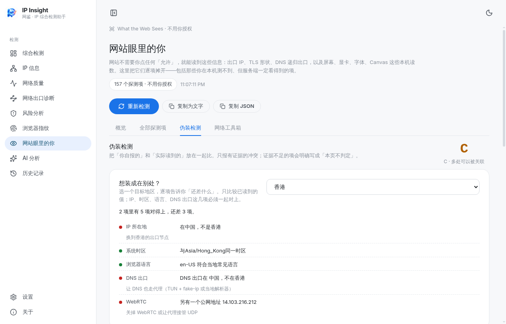
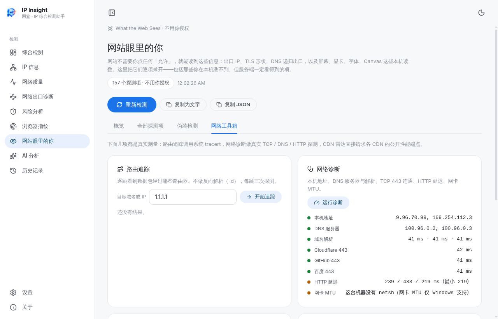

# 网站眼里的你 · 功能说明（0.3.1）

左侧导航「网站眼里的你」（眼睛图标，排在「浏览器指纹」之后）。这一页跟「浏览器指纹」不是重复：指纹页比对的是**多家检测网站各自算出的指纹**，这一页回答的是**网站到底能读到哪些原始读数、这些读数合起来能怎么认出你**。

页面顶部三个按钮：重新检测 / 复制为文字 / 复制 JSON；四个标签：概览、全部探测项、伪装检测、网络工具箱。

## ① 概览：一句话结论 + 暴露等级

读完后先给结论，例如：

> 你的浏览器语言是 zh-CN，系统时区 Asia/Shanghai；IP 落在 中国 陕西 西安。设备：Windows · 1920×1080 · 1 倍 · 24 位色。字体列表读到 20/60 种。这是本机第一次记录指纹，下次打开可以对比。明确冲突 1 处：DNS 泄漏。

右侧给 A–D 暴露等级（A 最干净），下方两栏 KV：地址与网络（出口 IP、归属、ASN、DNS 出口、最近节点与 RTT）、设备与环境（系统 / 浏览器、屏幕、显卡、CPU / 内存、时区与语言、深浅色、自动化痕迹）。再往下是指纹稳定性 chips（7 个分项各自「没变 / 变了」）和一份 OpenRTB 竞价请求预览。

## ② 全部探测项：157 项，逐项写清「为什么这项会暴露你」

| 分组 | 项数 | 读到什么 |
| --- | --- | --- |
| 服务器看到的 | 28 | 出口 IP、归属、ASN、Tor 出口比对、DNS 解析器出口与 ECS、TLS 版本与套件、WARP 状态、IPv6 出口、反向解析、最近数据中心与 RTT |
| 请求头 | 8 | User-Agent、Accept-Language、Sec-CH-UA 系列（品牌 / 平台 / 架构 / 型号 / 位宽）、压缩方式、DNT / GPC、Referer |
| 语言和地区 | 15 | navigator.languages、Intl 区域 / 历法 / 数字 / 日期格式、系统时区与时钟制、一周起始日、键盘布局、朗读语音数量 |
| 指纹 | 28 | Canvas / WebGL / 音频 / 数学函数 / Emoji 版本 / 字体列表 / DOMRect / SVG / 文字度量 / WebGL 读回像素 / 引擎接口计数 / 计时精度 / 递归深度 / 综合指纹 / 硬件编号 / 缓存 ETag / 谎言检测 / 防指纹开关 |
| 设备 | 47 | 系统与浏览器（含 Client Hints）、CPU 架构、屏幕与窗口、刷新率、显卡与软件渲染、WebGPU、CPU 线程、内存、触控、电池、摄像头麦克风、音频硬件、生物识别、蓝牙、VR/AR、编解码、录制格式、DRM、存储配额 |
| 浏览器设置 | 27 | 深浅色、动画偏好、色域、辅助功能、默认字号与强调色、权限、敏感接口、PDF、内置 AI、自动化痕迹、扩展与广告拦截、本标签页历史、存储留痕 |
| 网络 | 4 | WebRTC 公网候选、局域网候选、IPv6 泄露、连接类型与下行估算 |

每行可展开看原始读数与来源方法；等级分「强识别 / 可缩小范围 / 公开信息」，用来判断哪一项值得改。

**稀有度怎么算**：只用本机历史对比，不做「全网 N 次检测里只有你是这个指纹」这类结论——没有公共样本库，编一个数字就是假的。

## ③ 伪装检测：把「你说的」和「实际读到的」放一起

13 组带证据的判定，只报有证据的冲突，证据不足写「本页不判定」：

| 判定 | 看什么 |
| --- | --- |
| DNS 泄漏 | 递归解析器出口所在国家 vs 出口 IP 所在国家 |
| 往返延迟 | 到最近 Cloudflare 数据中心的 RTT 是否明显高于直连基线 |
| 连接指纹 | TLS / HTTP2 / TCP 层特征与 UA 声称的系统是否对得上（本机只能读到 TLS 协议与套件，TCP/IP 指纹标「仅服务端可观测」） |
| 时区 / 语言 | 系统时区、浏览器语言是否与 IP 归属地自相矛盾 |
| WebRTC | 有没有额外的公网候选暴露真实地址 |
| 机房 IP | 归属是否被标为 hosting / proxy |
| UA 与真实系统 | UA 声称的平台 vs Client Hints / 引擎能力探测 |
| 环境被篡改 | 常见接口是否被改写（`Function.prototype.toString` + iframe 对照） |
| 指纹浏览器痕迹 | 各项读数之间是否自相矛盾 |
| 自动化痕迹 | `navigator.webdriver`、Electron / headless 特征 |
| HTTP/3 与 ECH | 本次是否走上 HTTP/3、ECH 是否生效 |
| 后量子密钥交换 | 密钥交换是不是 X25519 而非混合后量子方案 |
| WARP | Cloudflare WARP / Gateway 状态 |

## ④ 目标地区模拟：想装成在别处，还差哪几项

选香港 / 新加坡 / 台湾 / 日本 / 美国 / 英国 / 德国，逐项比较 IP 归属、系统时区、浏览器语言、DNS 出口、WebRTC，输出「哪几项对得上、还差几项、每项怎么改」。只比较已读到的值，读不到的项不参与打分。

## ⑤ 网络工具箱：三项真实测量

- **路由追踪**：调用系统 `tracert -d`，最多 22 跳，逐跳 RTT，超时跳单独标注；
- **网络诊断**：本机地址、DNS 服务器、DNS 解析、TCP 443（Cloudflare / GitHub / 百度）、HTTP 延迟、网卡 MTU 共 8 项，逐项给通过 / 警告 / 失败与证据；
- **CDN 雷达**：并发请求 10 个 CDN 的公开性能端点，识别节点标识、缓存信号与耗时。

工具箱下方还有四个快捷入口，直接跳到已有的「网络质量」测速、「风险分析」（IP 质量）、「网络出口诊断」（网络透视）、「浏览器指纹」。

## 实际限制（写清楚，免得误读）

- **5 项只有服务端能观测**（JA4、HTTP/2 指纹、TCP/IP 指纹、QUIC 指纹、UA 回显）：界面标「仅服务端可观测」，不伪造本机读数。
- **ECH / 后量子**：`/cdn-cgi/trace` 不返回这两项，页面写「本页不判定」。
- **字体探测是近似**：靠 measureText 宽度比对，装了非常规字体或改过字体回退时可能漏判。
- **WebGL / WebGPU 在虚拟机、远程桌面或关闭硬件加速时读不到**，对应项显示「读不到」而不是「无」，也不据此判定虚拟化。
- **读数不写入历史、不参与 AI 分析**；需要留存时用「复制 JSON」。
- `tracert` / `netsh` 仅 Windows 有效；其他平台如实报「本机不支持」，不给假结果。

每一项的来源与测法：[whoami-data-sources.md](whoami-data-sources.md)。实测记录：[verification-0.3.1.md](verification-0.3.1.md)。
