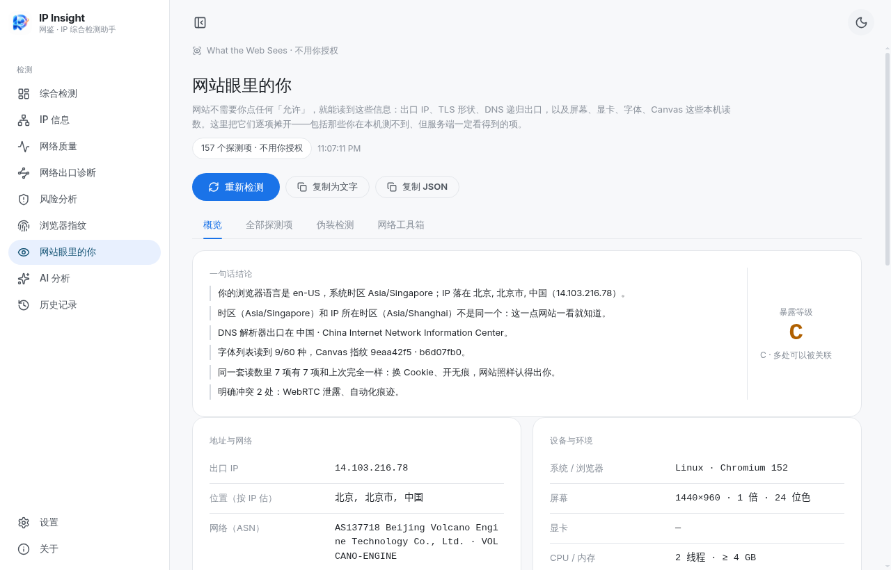

# IP Insight v0.3.1 发布说明

**发布日期**：2026-11-13
**版本**：0.3.1（上一版 0.2.3）
**主题**：网站眼里的你

---

## 一句话

新增一级页面「网站眼里的你」：把网站不用你点「允许」就能读到的 157 项信息逐条摊开，并判断你的代理 / VPN / 指纹伪装有没有露馅。同时补齐网络透视、IP 质量、网速、路由追踪、网络诊断、CDN 雷达这些实战工具。



## 新增：网站眼里的你

左侧导航新增「网站眼里的你」（眼睛图标，排在「浏览器指纹」之后），四个标签：

### ① 概览

- 一句话结论（语言、时区、IP 归属、设备、字体数量、首次/再次访问）；
- A–D 暴露等级；
- 地址与网络 / 设备与环境两栏读数；
- 指纹稳定性：Canvas、WebGL、音频、字体列表、屏幕、系统时区、浏览器语言 7 项与上次对比；
- OpenRTB 竞价请求预览（只在本页展示，不对外发送）。

### ② 全部探测项（157 项）

| 分组 | 项数 |
| --- | --- |
| 服务器看到的 | 28 |
| 请求头 | 8 |
| 语言和地区 | 15 |
| 指纹 | 28 |
| 设备 | 47 |
| 浏览器设置 | 27 |
| 网络 | 4 |

每项都写清读到什么、来源方法、为什么这项会暴露你；等级分「强识别 / 可缩小范围 / 公开信息」。支持搜索、按组筛选、展开原始证据、复制为文字 / JSON。

### ③ 伪装检测（13 组带证据的判定）

DNS 泄漏、往返延迟、连接指纹、时区 / 语言与 IP、WebRTC、机房 IP、UA 与真实系统、环境被篡改、指纹浏览器痕迹、自动化痕迹、HTTP/3 与 ECH、后量子密钥交换、WARP。只报有证据的冲突，证据不足写「本页不判定」，每条附改法。

**目标地区模拟**：香港 / 新加坡 / 台湾 / 日本 / 美国 / 英国 / 德国，逐项告诉你还差哪几项、每项怎么改。

### ④ 网络工具箱

- **路由追踪**：`tracert -d`，最多 22 跳，逐跳 RTT，超时跳单独标注；
- **网络诊断**：本机地址、DNS 服务器、DNS 解析、TCP 443（Cloudflare / GitHub / 百度）、HTTP 延迟、网卡 MTU 共 8 项；
- **CDN 雷达**：并发请求 10 个 CDN 公开性能端点，识别节点、缓存信号与耗时，失败项显示「失败」并悬浮给出原因；
- 四个快捷入口：测速、IP 质量、网络透视、浏览器指纹。

## 修复与打磨

- 虚拟显卡误判：原先「未检测到虚拟显卡特征」被当成警告，现改为只在检测到特征时提示，读不到时降级为普通信息；
- 空值文案：未取到 IP 归属时不再输出「IP 落在 。」这类半截句；
- WebGL 不可用时，显卡项显示「读不到」并说明原因，而不是写「无」；
- 加载态不再提前显示 A 级与半空结论，完成前只显示加载占位；
- 雷达与诊断失败项不再直接塞 `net::ERR_CERT_…`，改为「失败」+ 悬浮原因；
- MTU 检查在缺少 `netsh` 时给出「这台机器没有 netsh（网卡 MTU 仅 Windows 支持）」，不再暴露原始 `spawn ENOENT`；
- 快捷入口去重，第四项改为「浏览器指纹」。

## 下载

| 文件 | 大小 | SHA-256 |
| --- | --- | --- |
| `IP-Insight-0.3.1-Setup.exe` | 115.4 MB | `2a276efa0ded74630b2aa971b036021a868236393b43bfd34f9b0eac110a7752` |
| `IP-Insight-Portable.zip` | 156.4 MB | `ac95cede941b64e75c24922dec28a20a6290a748fd9533a7f4441126d5308b46` |

校验：

```powershell
certutil -hashfile IP-Insight-0.3.1-Setup.exe SHA256
```

安装包未签名，首次运行如遇 SmartScreen：点「更多信息 → 仍要运行」。也可按 README 从源码构建。

## 已知限制（写清楚，免得误读）

- JA4、HTTP/2、TCP/IP、QUIC 指纹与 UA 回显这 5 项只有服务端能观测，界面明确标注，不伪造本机读数；
- ECH / 后量子密钥交换：`/cdn-cgi/trace` 不返回，页面写「本页不判定」；
- 没有公共样本库，因此不做「全网 N 次检测只有你是这个指纹」的稀有度结论；
- 字体探测靠 measureText 近似，非常规字体或改过字体回退时可能漏判；
- 「网站眼里的你」的读数不写入历史、不参与 AI 分析，需要留存请用「复制 JSON」；
- `tracert` / `netsh` 仅 Windows 可用，其它平台如实报不支持。

## 升级说明

- 覆盖安装即可，设置与历史记录保留在原 `%AppData%/IP-Insight/` 目录；
- 「网站眼里的你」的指纹基线写在浏览器 localStorage 里，键名 `ipinsight.whoami.lastFingerprint.v1`；0.3.1 是首次引入，所以第一次打开没有历史基线，会标「本机第一次记录」；
- 无破坏性数据迁移。

## 致谢

问题清单的灵感来自 [who.1ms.dog](https://who.1ms.dog/zh-cn/) 这类科普站；本项目为独立实现，未复制其代码或数据。感谢 Cloudflare、Akamai、Tor Project、ip-api、ipwho.is 提供的公开诊断端点。

完整变更：[CHANGELOG.md](https://github.com/xueze-ai/IP-Insight/blob/main/CHANGELOG.md) · 实测记录：[docs/verification-0.3.1.md](https://github.com/xueze-ai/IP-Insight/blob/main/docs/verification-0.3.1.md)
